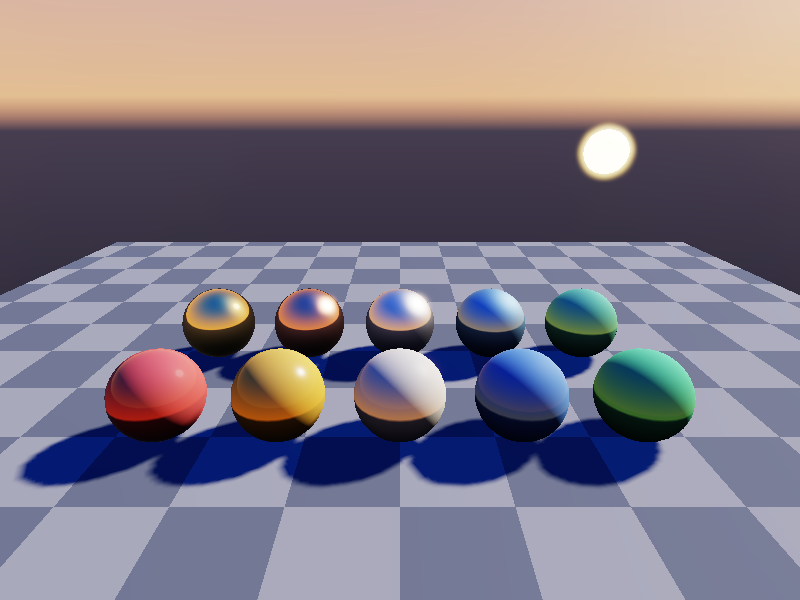
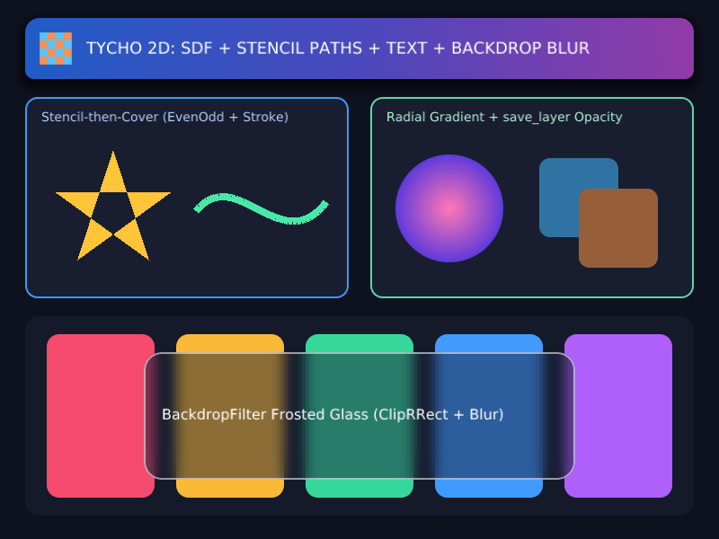
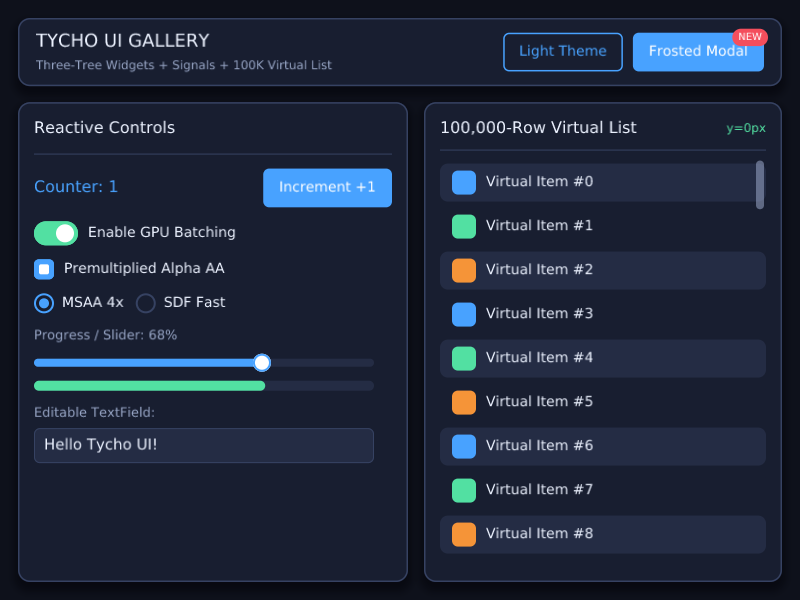

# Tycho — Pure-MoonBit Native Graphics Stack

> Write Vulkan & RHI graphics code directly in MoonBit with **zero user C**, packaged cleanly for [mooncakes.io](https://mooncakes.io) under the `laplaceliu/*` namespace.



*Rendered in pure MoonBit via `examples/49-rhi-pbr-showcase`.*


*2D SDF UI batching & high-frequency `CpuToGpu` ring-SSBO benchmark via `examples/53-rhi-2d-sdf-batch`.*



*`laplaceliu/tycho_2d` showcase via `examples/54-tycho-2d-showcase`.*



*`laplaceliu/tycho_ui` declarative gallery via `examples/55-tycho-ui-gallery`.*

## Architecture (Multi-Module Workspace)

| Module (`mooncakes.io`) | Directory | Purpose | Native Link Deps |
|---|---|---|---|
| `laplaceliu/tycho_vulkan` | `vulkan/` | Pure-MoonBit Vulkan bindings generated from `vk.xml` 1.4.363 (root package, headers vendored in-package: no Vulkan SDK needed; runtime loads `libvulkan.so.1` / `vulkan-1.dll` / `libvulkan.1.dylib` / `MoltenVK` dynamically) | *(none)* |
| `laplaceliu/tycho_dx12` | `dx12/` | Pure-MoonBit Direct3D 12 bindings (M1a minimal hand-written surface: device, command list, DXIL pipeline, render target, readback; runtime loads `d3d12.dll` / `dxgi.dll`, no import libs) | *(none)* |
| `laplaceliu/tycho_window` | `window/` | Thin native window + input events + Vulkan WSI surface helper across Linux (Wayland/X11 via `dlopen`), Windows (Win32 via `LoadLibraryA`), and macOS (Cocoa + `CAMetalLayer` via `dlopen`) | *(none)* |
| `laplaceliu/tycho_shader` | `shader/` | GLSL (`glslangValidator`), Slang (`slangc`), pure-MoonBit SPIR-V reflection (`reflect_spirv`), & PPM/BMP/PNG/HDR image helpers | *(none)* |
| `laplaceliu/tycho` | `tycho/` | Unified pure-MoonBit RHI over Vulkan 1.3 dynamic rendering, sync2, 2 frames-in-flight, free-list sub-allocator, auto-reflected pipelines (`from_spirv`), MRT, mipmaps, storage images, bindless, mesh shaders, inline Ray Query (BLAS/TLAS), stencil state, and GPU timestamps; typed math seams via `tycho_math` (`push_constants_mat4`, `RayInstanceDesc::from_affine3`) | *(none)* |
| `laplaceliu/tycho_math` | `math/` | Zero-dependency pure-MoonBit fixed-dimension graphics & geometry math: `Vec2/3/4`, `IVec`/`UVec`, `Quat`, column-major `Mat2/3/4`, `Affine2/3`, `Transform`, clip-space-aware projections, `Ray`/`Aabb`/`Frustum`, std140/std430 packing, batch kernels | *(none)* |
| `laplaceliu/tycho_2d` | `2d/` | Skia/Impeller-inspired pure-MoonBit 2D engine: `Canvas`/`DisplayList`, AOT embedded SPIR-V pipelines, Tier-1 SDF/gradient/atlas batcher, pure-MoonBit TrueType + built-in font & `Paragraph` layout, Tier-2 Stencil-then-Cover paths & strokes, `save_layer`, and Gaussian `BackdropFilter` blur | *(none)* |
| `laplaceliu/tycho_ui` | `ui/` | Flutter-inspired declarative UI framework: Widget/Element/RenderObject/Layer trees, fine-grained `Signal[T]`, single-pass `BoxConstraints` (`Row`/`Column`/`Stack`/`Wrap`), `GestureArena`, `TextField`, `ThemeData`, virtualized `ListView`, `AppRunner` & headless `WidgetTester` | *(none)* |
| `laplaceliu/tycho_codegen` *(private)* | `codegen/` | Khronos `vk.xml` → MoonBit + C shim generator | *(none)* |
| `laplaceliu/tycho_vulkan_examples` *(private)* | `examples/` | Pure-MoonBit examples & suites (low-level Vulkan API suites + unified `@tycho` / `@tycho_math` / `@tycho_2d` / `@tycho_ui` demos, Wayland check & benchmarks) | *(none)* |

Documentation:
- [Architecture Overview](docs/architecture.md)
- [RHI Programming Guide](docs/rhi-guide.md)

Planned next phase:
- Grow `laplaceliu/tycho_dx12` from its M1a hand-written surface to the generated full binding + DXGI presentation, then add the DX12 backend under `laplaceliu/tycho`.
- Add `laplaceliu/tycho_metal` (macOS/iOS), plus cross-platform shader compilation (SPIR-V today, DXIL/MSL artifacts next).

## Key Design Improvements for `mooncakes.io`

1. **Clean root package import**: users import `"laplaceliu/tycho_vulkan" @vk` or `"laplaceliu/tycho" @tycho` directly (no `/generated` subpackage).
2. **Self-contained vendored headers**: Vulkan 1.4.363 C headers (including `vk_video/`) live inside `vulkan/include/vulkan/` and are included via relative `#include "include/vulkan/vulkan.h"` — requiring **zero `-I` flags** and **zero Vulkan SDK** for downstream consumers. `1.4.363` is only the Khronos header/spec revision shipped with the package: it never forces a matching loader, because every command is fetched through `vkGetInstanceProcAddr` / `vkGetDeviceProcAddr` and the RHI requests API version **1.3**.
3. **Zero link flags across Linux, Windows & macOS**: `laplaceliu/tycho_vulkan` and `laplaceliu/tycho_window` load Vulkan (`libvulkan.so.1` / `vulkan-1.dll` / `libvulkan.1.dylib` / `libMoltenVK.dylib`) and windowing libraries (`libwayland-client.so.0`, `libX11.so.6`, `user32.dll`, `AppKit` + `QuartzCore`) dynamically at runtime, so downstream executables need **no `cc-link-flags`** (`-lvulkan`, `-lX11`, `vulkan-1.lib`, or `-framework`). `vk.xml` stays in `codegen/registry/` so the published `laplaceliu/tycho_vulkan` tarball stays compact (~1.3 MB).
4. **Compile-time ABI audit**: generated stubs embed thousands of static-assert checks (`_Static_assert` / C89 fallback for MSVC) enforcing `sizeof(C type) <= MoonBit type width` across all generated struct fields and scalar command parameters.

## Runtime Requirements (downstream users)

The `1.4.363` number is the Khronos header/spec revision used **at generation time only**. It does not dictate what the end user must install:

| Requirement | Why | Not required |
|---|---|---|
| Vulkan loader (`libvulkan.so.1` / `vulkan-1.dll` / `libvulkan.1.dylib` or `libMoltenVK.dylib`) ≥ 1.3 | RHI creates the instance with `apiVersion = 1.3` (`tycho/vk_backend.mbt`) | LunarG **Vulkan SDK** at build time |
| GPU driver supporting Vulkan 1.3 (`dynamicRendering` + `synchronization2`, e.g. NVIDIA, AMD, Mesa `lavapipe`, MoltenVK) | RHI core path; checked explicitly, missing support raises `DeviceFailed` instead of crashing | matching 1.4.363 headers on the system |
| Zero `cc-link-flags` in `moon.pkg` | Dynamic runtime loading (`dlopen` / `LoadLibraryA`) replaces `-lvulkan`, `-lX11`, `-framework Cocoa`, and `vulkan-1.lib` | `-I`, `VULKAN_SDK`, `-lX11`, or `libx11-dev` / `libvulkan-dev` |

Bindings never reference 1.4-only entry points: all 813 commands go through `vkGetInstanceProcAddr` / `vkGetDeviceProcAddr`, so an older 1.3 loader is enough (verified against `libvulkan.so.1.3.204` on Ubuntu 22.04, which does not even export 1.4 or `NV` extension symbols). On a pre-1.3 loader the RHI reports `VK_ERROR_INCOMPATIBLE_DRIVER` with an explicit hint.

## Upgrading to a Newer Vulkan SDK / `vk.xml`

Bindings are generated, not hand-written, so an upstream bump is a regeneration rather than a port:

```bash
./tools/update-vulkan-headers.sh /path/to/VulkanSDK/<new>/x86_64   # headers + vk.xml
./generate.sh                                                      # vk.xml -> 6 generated files, rebuild
./check-generated.sh                                               # committed output must match
moon test --target native
./tools/run-all.sh both && ./tools/coverage.py
```

Automatic on upgrade:

| Area | Behaviour |
|---|---|
| New commands | `Entry` / `InstanceFn` / `DeviceFn` regenerate; pointers stay lazily resolved, so a new command adds no link-time dependency |
| New structs / members | accessors and `sType` auto-fill regenerate from `vk.xml` |
| ABI drift | regenerated `_Static_assert(sizeof(C field) <= MoonBit width)` fails the build loudly instead of corrupting memory |
| New enum / bitmask values | typed `UInt32` / `UInt64` constants; 64-bit groups are detected from the header typedefs |
| Types with platform-only members | skipped, not fatal — the rest of the binding still builds |

Still manual:

1. **New platform header**: the update script only refreshes the headers this package already vendors and *lists* the ones upstream adds; pass `--add-headers` to adopt them (this also widens the compilable surface that `tools/coverage.py` measures). If a backend needs one, add a matching `VK_USE_PLATFORM_*` entry to the `platforms` map in `codegen/main.mbt` (plus WSI wiring in `tycho_window`).
2. **The RHI is hand-written** and stays on Vulkan 1.3: header bumps do not move its runtime requirement. Adopting a newer core version is a deliberate change in `tycho/vk_backend.mbt` (`set_apiVersion`), not part of an upgrade.
3. **Doc numbers** (`813` commands, `5,520` constants, `664/664` coverage) are quoted for 1.4.363 and need a refresh; `tools/coverage.py` recomputes them from `vk.xml`.
4. **Package versions**: bump the seven published `moon.mod` versions (`vulkan`, `shader`, `window`, `math`, `tycho`, `2d`, `ui`) and republish in dependency order; dependents pin exact versions (`@0.7.0` / `@0.8.1` / `@0.9.0` today), so their `import` lines move too.

## Linux Vulkan API Coverage

`./build.sh && ./tools/run-all.sh both` is the release gate: it exercises all 55 example
packages (`examples/01` … `examples/55`) on both `lavapipe` and `nvidia` and fails on any
validation error.
`OK` always implies at least one executed command: an example whose extension batch a driver
cannot provide reports `SKIP` (exit 0, tallied separately by `tools/run-all.sh`), and an example
that advertises a group but executes none of it reports `FAIL`:
- Desktop Vulkan commands in `vk.xml`: **813 / 813** exercised in pure MoonBit
- Host-reachable commands on Linux (`lavapipe` + `nvidia`): **664 / 664 (100.0%)**

## Quick Start (Linux)

```bash
# 1. Setup C99 compiler toolchain & check native dependencies
./setup-linux.sh

# 2. Build all modules and verification suites
./build.sh

# 3. Run unit tests
moon test --target native

# 4. Run all 55 pure-MoonBit verification examples on lavapipe + NVIDIA
./tools/run-all.sh both

# 5. Measure reproducible Linux Vulkan API coverage
./tools/coverage.py

# 6. CI gates
./check-generated.sh       # codegen zero-diff check
./check-examples-pure.sh   # assert zero .c / native-stub in examples
./check-math-layering.sh   # tycho_math stays a leaf; RHI uses @tmath only in its façade
```

## Publishing to `mooncakes.io`

Install in downstream MoonBit packages with:

```bash
moon add laplaceliu/tycho_vulkan
moon add laplaceliu/tycho_shader
moon add laplaceliu/tycho_window
moon add laplaceliu/tycho
moon add laplaceliu/tycho_math
moon add laplaceliu/tycho_2d
moon add laplaceliu/tycho_ui
```

No native `cc-link-flags` are needed in downstream `moon.pkg` files on Linux, Windows, or macOS — Vulkan and OS windowing APIs are resolved dynamically at runtime.

Or publish from source in dependency order (after `moon login` as `laplaceliu`):

```bash
(cd vulkan && moon publish)
(cd shader && moon publish)
(cd window && moon publish)
(cd math && moon publish)   # tycho depends on it, so math goes first
(cd tycho && moon publish)
(cd 2d && moon publish)
(cd ui && moon publish)
```

Use `moon publish --dry-run` to validate packaging and standalone `moon check` before releasing.
