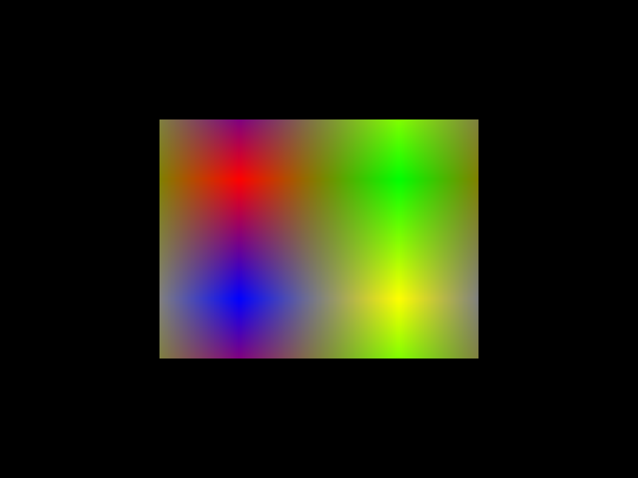

# 06-texture

Example 06 — Textures (vulkan-tutorial.com/Textures).

Texture image + memory + layout transitions (pipeline barriers) + buffer->image copy
+ sampler + combined-image-sampler descriptor + textured quad.

## Window Screenshot



## Run

```bash
./build.sh
./_build/native/debug/build/laplaceliu/tycho_vulkan_examples/06-texture/06-texture.exe
```

## Output

```text
[06-tex] texture image created + uploaded + transitioned
[06-tex] sampler = 0
[06-tex] graphics pipeline (texture) = 0
[render] non-zero pixels=120000/480000
[06-tex] acquire=0 submit=0 present=0 (0=VK_SUCCESS)
[06-tex] OK — texture chapter validated
```
