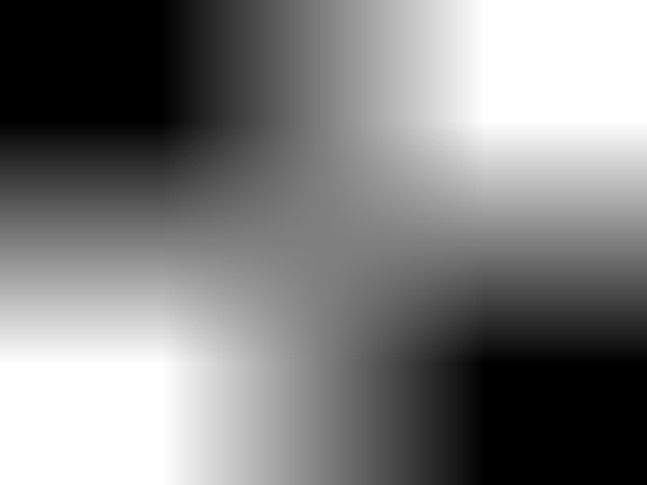

# 13-rhi-sampler

Compares `Filter::Nearest` vs `Filter::Linear` on a 2x2 checkerboard texture using `@tycho`.

## Run

```bash
./build.sh
./_build/native/debug/build/laplaceliu/tycho_vulkan_examples/13-rhi-sampler/13-rhi-sampler.exe
```

## Screenshot



> Runs headless by default for automated verification. Pass `--window` (or `TYCHO_WINDOW=1`) to render on screen.
