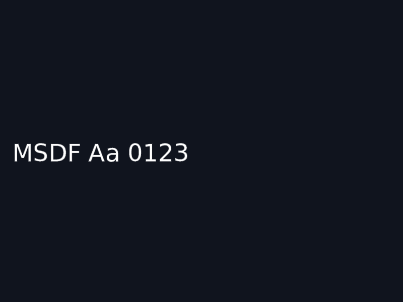

# 2d/msdf — MSDF scale quality

Renders the same paragraph at 0.5×/1×/2×/4× with the RGBA MSDF atlas
(`kind=9`) and with the normal bitmap glyph path, then compares each pair with
windowed SSIM. The gate requires every scale ≥ 0.98.

```sh
cd tycho/examples
moon build --target native 2d/msdf
./_build/native/debug/build/laplaceliu/tycho_vulkan_examples/2d/msdf/msdf.exe
```

## Screenshot



> Runs headless by default. Pass `--window` for interactive display or
> `--screenshot <path>` to capture PNG.

Sample output:

```json
{"scores":[0.9994091112342799,0.9973060147371698,0.9949897800104068,0.9913249895088599],"worst":0.9913249895088599,"errors":0}
[2d/msdf] OK — 0.5x/1x/2x/4x SSIM worst=0.9913249895088599, 0 validation errors
```
