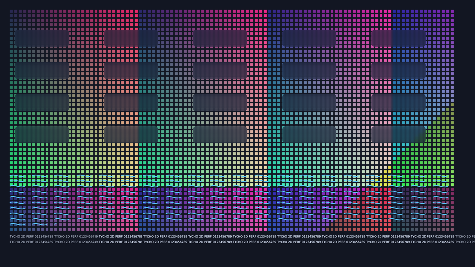

# 2d/perf — Tycho 2D performance harness

A headless 1920x1080 scene used to track M6 frame-structure work:

- 5,000 Tier-1 SDF primitives (100 x 50 grid)
- ~1,000 glyphs (10 long paragraphs)
- 200 anti-aliased cubic stroke paths
- 20 frosted-glass `save_backdrop_layer` panels

It renders one frame through `Renderer2D::render_offscreen`, prints a JSON line
of `RenderStats`, and asserts that batching is active (draw calls well below the
primitive count, path passes well below the path count, non-zero upload bytes,
zero validation errors).

## Run

```sh
cd tycho/examples
moon build --target native 2d/perf
./_build/native/debug/build/laplaceliu/tycho_vulkan_examples/2d/perf/perf.exe
```

## Screenshot



> Runs headless by default. Pass `--window` for interactive display or
> `--screenshot <path>` to capture PNG.

Sample output on NVIDIA:

```json
{"draws":23,"path_passes":30,"prims":5861,"uploads":1649600,"glyphs":20,"atlas_images":0,"atlas_resets":0,"atlas_overflows":0,"coverage_draws":0,"coverage_entries":0}
[2d/perf] OK — 5861 prims, 23 draws, 30 path passes, 1649600 upload bytes, 0 validation errors
```
