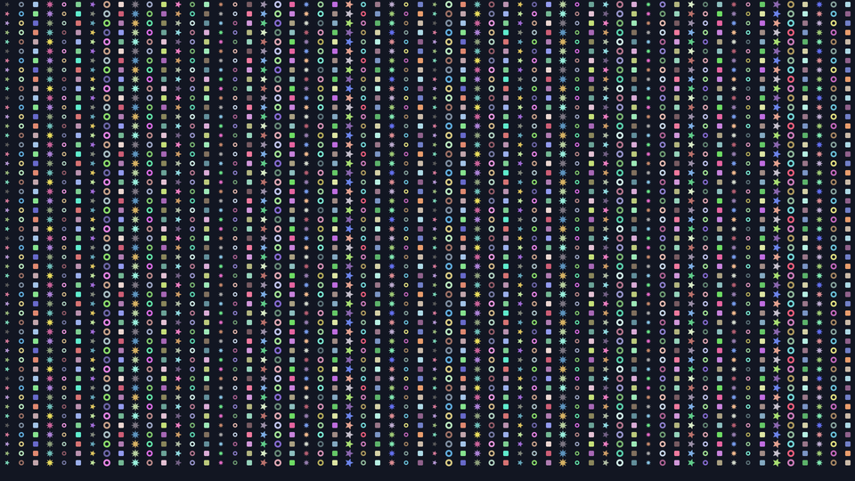

# 2d/svg-icons — coverage atlas quality gate

Renders 300 procedural icon paths (concave stars, EvenOdd rings, rounded
squares) at 1920x1080 twice:

1. through the CPU coverage atlas (one batched draw, zero MSAA passes);
2. through the per-path 4x MSAA fallback.

The two images are compared with a windowed 8x8 SSIM and the gate requires
SSIM >= 0.98, coverage draws == icon count, and zero validation errors.

## Run

```sh
cd tycho/examples
moon build --target native 2d/svg-icons
./_build/native/debug/build/laplaceliu/tycho_vulkan_examples/2d/svg-icons/svg-icons.exe
```

## Screenshot



> Runs headless by default. Pass `--window` for interactive display or
> `--screenshot <path>` to capture PNG.

Sample output on NVIDIA:

```json
{"ssim":0.9944478052586458,"coverage_draws":3000,"coverage_passes":0,"msaa_passes":400,"coverage_draw_calls":2,"msaa_draw_calls":1}
[2d/svg-icons] OK — SSIM=0.9944, coverage 3000 icons / 0 passes, MSAA 400 passes, 0 validation errors
```
