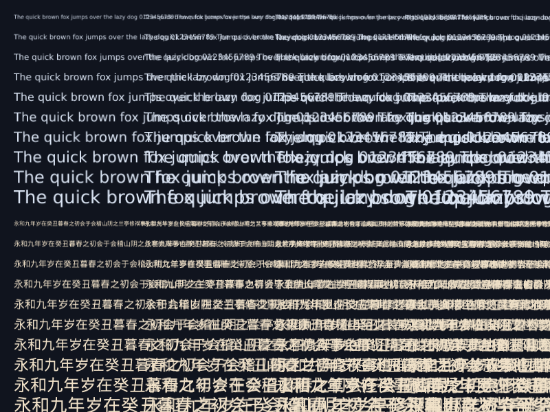

# 2d/text-stress — text stress test

Renders ~8,000 glyphs across 40 fractional sizes per script at 800x600:

- Latin: DejaVuSans.ttf
- CJK: DroidSansFallbackFull.ttf

The gate asserts that the enlarged 4096² glyph atlas plus LRU compaction keeps
`atlas_resets == 0` and `atlas_overflows == 0`, with more than 2,500 glyph
entries and 6,000 primitives.

## Run

```sh
cd tycho/examples
moon build --target native 2d/text-stress
./_build/native/debug/build/laplaceliu/tycho_vulkan_examples/2d/text-stress/text-stress.exe
```

## Screenshot



> Runs headless by default with pixel/atlas assertions. Pass `--window` for
> interactive display or `--screenshot <path>` to capture PNG.

Sample output:

```json
{"glyphs":5040,"resets":0,"overflows":0,"prims":7881}
[2d/text-stress] OK — 5040 glyph entries, 7881 prims, 0 atlas resets/overflows, 0 validation errors
```
