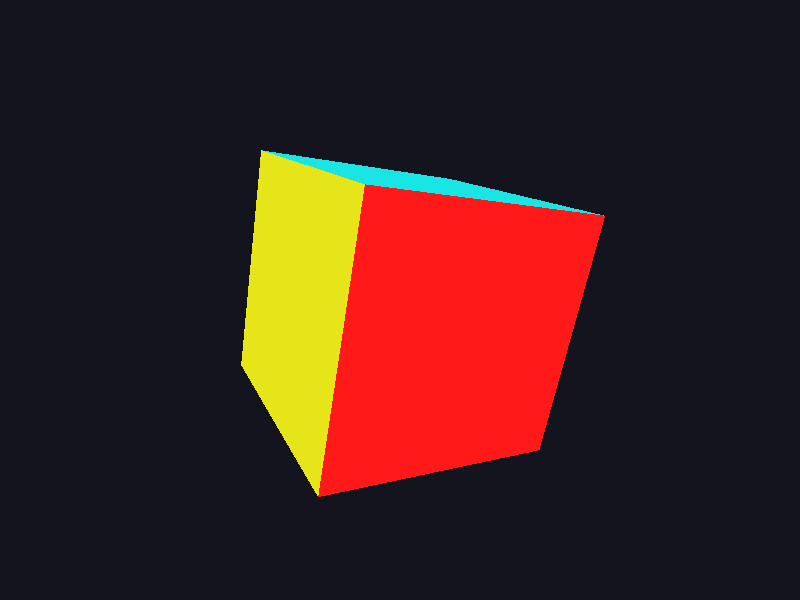

# 38-rhi-3d-cube

Rotating 3D colored cube rendered with `laplaceliu/tycho` (`@tycho`), exercising:
- Depth buffering (`SwapchainDesc` with `depth=true`)
- Back-face culling (`CullMode::Back`, `FrontFace::CounterClockwise`)
- Index buffers (`BufferKind::Index`, `IndexType::Uint16`, `draw_indexed`)
- Push constants (`push_constant_size=64` for MVP matrix)
- Window input event polling (`poll_events` + `KEY_ESCAPE`)
- GPU sub-allocator (`allocator_stats`)

## Run

```bash
./build.sh
./_build/native/debug/build/laplaceliu/tycho_vulkan_examples/38-rhi-3d-cube/38-rhi-3d-cube.exe
```

## Screenshot



> Runs headless by default for automated verification. Pass `--window` (or `TYCHO_WINDOW=1`) to render on screen.
