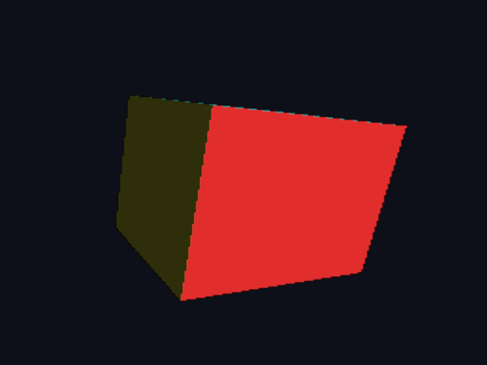

# 42-rhi-mrt-postprocess

Two-pass deferred shading pipeline using pure-MoonBit `@tycho`:
1. Offscreen Multiple Render Targets (MRT) G-Buffer pass writing albedo (`RGBA8`), encoded world normals (`RGBA8`), and depth (`Depth32F`), auto-reflected via `PipelineDesc::from_spirv` and timed with `TimestampPool`.
2. Fullscreen deferred directional lighting pass sampling both G-Buffer attachments onto the swapchain.

## Run

```bash
./build.sh
./_build/native/debug/build/laplaceliu/tycho_vulkan_examples/42-rhi-mrt-postprocess/42-rhi-mrt-postprocess.exe
```

## Screenshot



> Runs headless by default for automated verification. Pass `--window` (or `TYCHO_WINDOW=1`) to render on screen.
