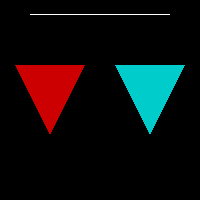

# 44-rhi-pipeline-instancing

Tests RHI v0.4 pipeline state descriptors and multi-stream instanced vertex layouts:
- `VertexBufferLayout` with `VertexStepMode::Vertex` (binding 0) + `VertexStepMode::Instance` (binding 1)
- `BlendMode::Additive` overlapping instanced draws
- `PrimitiveTopology::LineList`
- `Device::pipeline_cache_data()` & `DeviceDesc::new(..., pipeline_cache=...)`

## Screenshot

> Runs headless by default for automated verification. Pass `--window` (or `TYCHO_WINDOW=1`) to render on screen.
