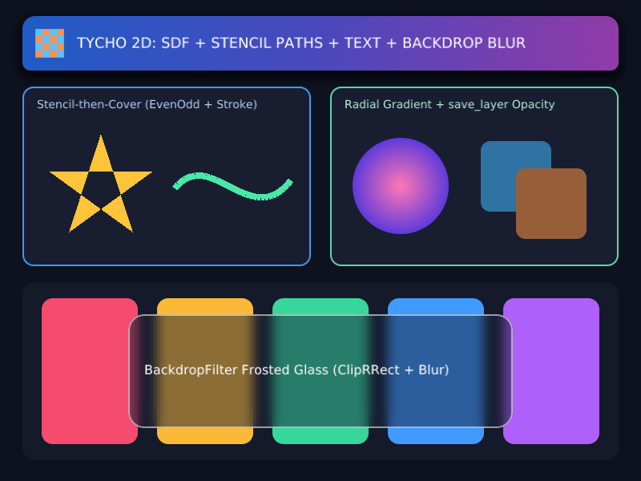

# 54-tycho-2d-showcase

Pure-MoonBit showcase of `laplaceliu/tycho_2d` (Skia / Impeller-inspired 2D engine over `@tycho`), demonstrating:

1. **Tier-1 SDF & Gradients**: Per-corner rounded rectangles, multi-stop linear/radial gradients, analytical drop shadows, RGBA8 image sprites, and `Paragraph` text (`DejaVuSans.ttf` via pure-MoonBit TrueType parser with automatic built-in font fallback).
2. **Tier-2 Vector Paths (Stencil-then-Cover)**: Self-intersecting 5-point star with `FillRule::EvenOdd` hollow center and cubic Bézier curve stroke (`StrokeCap::Round`, `StrokeJoin::Round`).
3. **Tier-3 Layer & Blur Passes**: Offscreen `save_layer` flat group opacity and `ClipRRect` + `save_backdrop_layer` Gaussian frosted-glass blur.

## Run

```bash
./build.sh
./_build/native/debug/build/laplaceliu/tycho_vulkan_examples/54-tycho-2d-showcase/54-tycho-2d-showcase.exe
```

## Screenshot



> Runs headless by default with pixel assertions and validation/leak gates. Pass `--window` for interactive display or `--screenshot <path>` to capture PNG.
