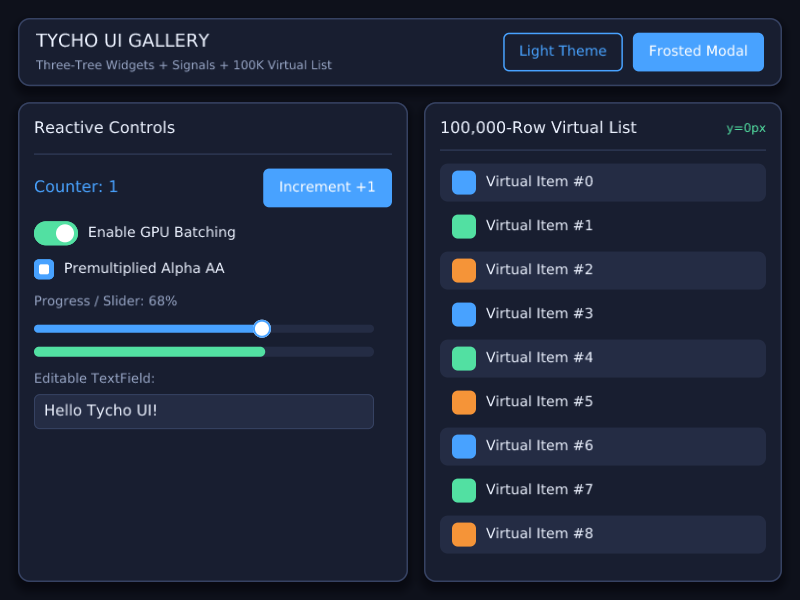

# 55-tycho-ui-gallery

Declarative Flutter-style UI Gallery built with `laplaceliu/tycho_ui` over `tycho_2d` and `@tycho`, demonstrating:

1. **Three-Tree Architecture + Reactive `Signal[T]`**: Automatic fine-grained dirty rebuilding across `ThemeData` (Dark/Light switcher), reactive counter, `switch_toggle`, `checkbox`, `slider`, `progress_bar`, `text_field`, and `frosted_dialog`.
2. **Single-Pass `BoxConstraints` Layout**: `row`, `column` (`gap`), `expanded`, `card`, `stack`, and `positioned`.
3. **100,000-Row Virtualized `list_view_builder`**: Only materializes visible + cache-buffer elements regardless of dataset size.
4. **Headless `WidgetTester` + Live Window**: Runs synthetic tap, text edit, and scroll assertions offscreen by default (`--window` launches full interactive GUI).

## Run

```bash
./build.sh
./_build/native/debug/build/laplaceliu/tycho_vulkan_examples/55-tycho-ui-gallery/55-tycho-ui-gallery.exe
```

## Screenshot



> Pass `--window` (or `TYCHO_WINDOW=1`) for interactive mouse/wheel/keyboard exploration, or `--screenshot <path>` to capture PNG.
