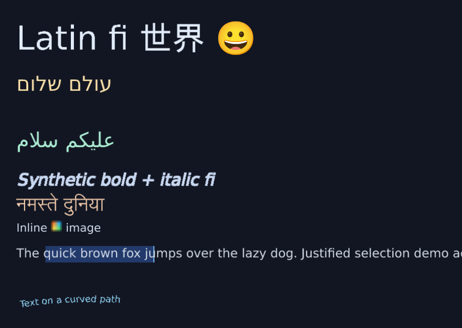

# 60 — i18n text

M8 integration example mixing:

- Latin with the `fi` -> `fi` presentation-form ligature
- CJK fallback (DroidSansFallbackFull)
- color Emoji (NotoColorEmoji via CBDT)
- Hebrew RTL visual order
- Arabic joining forms (Presentation Forms-B)
- Justified paragraph, selection boxes and caret

The fallback chain is DejaVuSans -> DroidSansFallbackFull -> NotoColorEmoji.
Latin ligatures use GSUB `liga` with glyph-id rendering; Arabic uses GSUB
`init/medi/fina/isol` joining plus `rlig` (lam-alef), with Presentation Forms-B
as fallback; GPOS `kern` is applied by glyph id. Indic clusters and full
UAX #9 remain future work.

## Run

```sh
cd tycho/examples
moon build --target native 60-tycho-2d-i18n-text
./_build/native/debug/build/laplaceliu/tycho_vulkan_examples/60-tycho-2d-i18n-text/60-tycho-2d-i18n-text.exe
```

## Screenshot



> Runs headless by default. Pass `--window` for interactive display or
> `--screenshot <path>` to capture PNG.

Sample output:

```json
{"ligature":true,"arabic_forms":7,"rtl_first":1501,"selection_boxes":1,"yellow_pixels":1157}
[60-tycho-2d-i18n-text] OK — Latin ligature + CJK + emoji + Hebrew RTL + Arabic joining, 7 Arabic forms, 0 validation errors
```
