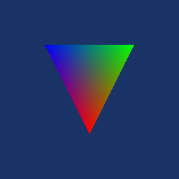

# 76-rhi-dx12-triangle

Runs the **Tycho RHI on the Direct3D 12 backend**. The user code is the same façade as
`08-rhi-triangle` — `Device` / `Swapchain` / `Pipeline` / `CommandBuffer` — with
`BackendKind::Dx12` in the device descriptor:

```moonbit
let dev = @tycho.Device::new_desc(
  @tycho.DeviceDesc::new("76-rhi-dx12-triangle", validation=true, headless=false,
    backend=@tycho.BackendKind::Dx12),
)
let sc = dev.create_swapchain_desc(@tycho.SwapchainDesc::new(..., enable_readback=true))
let pipe = sc.create_pipeline(dx12_rhi_vs, dx12_rhi_ps, 0)
let cmd = sc.begin_frame()
cmd.bind_pipeline(pipe)
cmd.draw(3, 1)
sc.end_frame(cmd)
```

## Screenshot



## Run

```powershell
moon build --target native examples/76-rhi-dx12-triangle
.\_build\native\debug\build\laplaceliu\tycho_vulkan_examples\76-rhi-dx12-triangle\76-rhi-dx12-triangle.exe
```

Expected:

```
[76-rhi-dx12-triangle] OK — RHI triangle on the DX12 backend (256x256, 3 frames, 3 vertex regions verified, 0 validation errors)
```

Add `--window` (or `TYCHO_WINDOW=1`) to keep presenting until the window is closed or `Esc` is
pressed, exactly like `08-rhi-triangle`; add `--screenshot <path>` (or `TYCHO_SCREENSHOT`) to write
the readback frame as PNG.

`TYCHO_DX12_WARP=1` forces WARP; non-Windows hosts report `SKIP`.

## Backend coverage

The DX12 half of the RHI implements windowed flip-model present, clear, draw and readback. Every
other operation (buffers, textures, samplers, descriptors, compute, indirect, mesh, ray tracing)
raises `RhiError::BackendUnsupported` from the backend accessors, so a program cannot silently get
"nothing happened" instead of a diagnostic.

**Shader artifacts**: `create_pipeline` keeps one entry point, whose blobs are SPIR-V on Vulkan and
**DXIL on DX12**. Emitting both artifacts from one shader source is the remaining piece
(`docs/original-design/03-dx12.md` §6.1 item 1); this example embeds its DXIL via
`tools/gen-dx12-shaders.py`.
