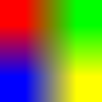

# 79-dx12-texture

Sampled texture on the DX12 backend — the counterpart of `11-rhi-texture`, rendered offscreen so it
needs no window.

## What it proves

| Piece | Detail |
|---|---|
| Texture upload | `Device::create_texture` uploads tightly packed RGBA8 through a UPLOAD-heap staging buffer into a `DEFAULT`-heap texture, then leaves it in `PIXEL_SHADER_RESOURCE` with a shader-visible SRV |
| Descriptor heap | the device owns a shader-visible heap; each uploaded texture takes one slot, and the command list calls `SetDescriptorHeaps` before binding |
| Root signature | one SRV descriptor table (`t0..t(n-1)`, space 0) plus **one sampler table** (`s0`, space 0) — the sampler is a real heap sampler because D3D treats a shader's `SamplerState` as a descriptor range and rejects a root-signature static sampler for it (the debug layer says so explicitly) |
| Slot model | `PipelineDesc::texture_slots = 1` becomes the SRV table; `bind_texture` points the table at the bound texture |

The 2x2 albedo (red / green / blue / yellow) is stretched over the viewport, so the four quadrants
must come back as those four colours; the screenshot shows the bilinear blend between them.

## Screenshot



## Run

```powershell
moon build --target native examples/79-dx12-texture
.\_build\native\debug\build\laplaceliu\tycho_vulkan_examples\79-dx12-texture\79-dx12-texture.exe
```

Expected:

```
[79-dx12-texture] OK — 2x2 albedo sampled through an SRV table + sampler heap (4/4 quadrants matched, 128x128, 0 validation errors)
```

`TYCHO_DX12_WARP=1` forces WARP; `--screenshot <path>` writes the verified frame. Non-Windows hosts
report `SKIP`.

## Regenerate the shader artifacts

```bash
python tools/gen-dual-shaders.py          # SPIR-V + DXIL from shader.slang
python tools/gen-dual-shaders.py --check  # drift gate (needs slangc)
```
