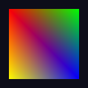

# 81-dx12-geometry

Vertex + index buffers on the DX12 backend, headless.

Before this slice the DX12 backend could only draw with `SV_VertexID`: `bind_vertex` and `bind_index`
were silent no-ops, so no real geometry could reach the GPU. This example is the first one whose
vertices come from a buffer.

## What it proves

| Piece | Detail |
|---|---|
| Input layout | `PipelineDesc.vertex_formats` becomes a real `D3D12_INPUT_ELEMENT_DESC` array (`float3` + `float4`, offsets 0 and 12, stride 28) instead of an empty layout |
| Vertex buffer | `Device::create_buffer(112, BufferKind::Vertex)` + `upload_floats`, bound through `IASetVertexBuffers` with the stride taken from the pipeline |
| Index buffer | `Device::create_buffer(24, BufferKind::Index)` + `upload_uint32`, bound through `IASetIndexBuffer` as `R32_UINT` |
| Indexed draw | `DrawIndexedInstanced` shares the render-target/viewport/scissor setup with the procedural draw, so the two paths cannot drift apart |

The quad is four coloured corners (red / green / blue / yellow) with an index buffer; the diagonal
of the two triangles passes through the centre, so the centre must be `(red + blue) / 2`.

## Semantic naming (the non-obvious part)

A SPIR-V location has no name, so the layout has to pick one. The rule the backend uses is
`TEXCOORD(location * 10)`, because that is what Slang's DXIL backend emits: a source `TEXCOORD0`
becomes semantic index 0, `TEXCOORD1` becomes **10**, `TEXCOORD5` becomes 50 (all three verified with
`dxc -dumpbin`). Using `TEXCOORD(location)` matches the source text but fails
`CreateGraphicsPipelineState` with "input signature expects TEXCOORD/10".

## Screenshot



## Run

```powershell
moon build --target native examples/81-dx12-geometry
.\_build\native\debug\build\laplaceliu\tycho_vulkan_examples\81-dx12-geometry\81-dx12-geometry.exe
```

Expected:

```
[81-dx12-geometry] OK — vertex + index buffers drew an indexed quad (centre=(126, 0, 129), 4/4 corners matched, 0 validation errors)
```

`TYCHO_DX12_WARP=1` forces WARP; `--screenshot <path>` writes the frame as PNG.

## Regenerate the shader artifacts

```bash
python tools/gen-dual-shaders.py          # SPIR-V + DXIL from shader.slang
python tools/gen-dual-shaders.py --check  # drift gate (needs slangc)
```
