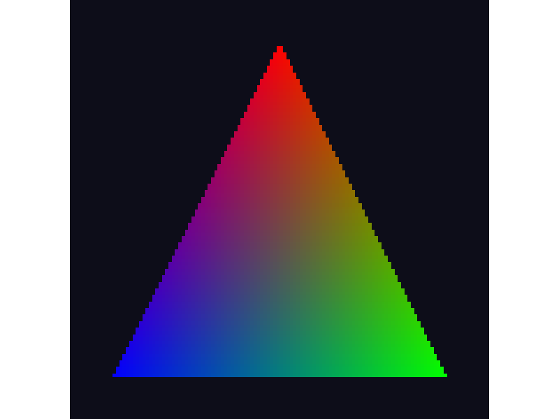

# dx12/mesh

Mesh shader pipeline on the DX12 backend, headless.

Nothing feeds this pipeline: no input layout, no vertex buffer, no index buffer. A single
`DispatchMesh(1,1,1)` launches one mesh-shader workgroup that writes the triangle.

## What it proves

| Piece | Detail |
|---|---|
| Stream-descriptor PSO | mesh pipelines cannot be built from `D3D12_GRAPHICS_PIPELINE_STATE_DESC`; the shim assembles a `D3D12_PIPELINE_STATE_STREAM_DESC` (root signature, MS, PS, blend, rasterizer, depth-stencil, RTV formats, sample desc, node mask, flags) and calls `ID3D12Device2::CreatePipelineState` |
| Device2 | `ID3D12Device2` is queried once and cached; the stream path needs it |
| DispatchMesh | `ID3D12GraphicsCommandList6::DispatchMesh`, queried per command list (RHI's `draw_mesh_tasks` maps to it) |
| No IA stage | the shader generates positions/colours itself, so the PSO carries no input layout at all |

## Two D3D12 details worth recording

1. **`D3D12_RT_FORMAT_ARRAY` ordering** — the struct is `DXGI_FORMAT RTFormats[8]; UINT NumRenderTargets;`,
   formats *before* the count. A hand-written equivalent with the fields swapped made
   `CreatePipelineState` fail with `E_INVALIDARG` and the debug layer report
   `RTVFormats[] must be DXGI_FORMAT_UNKNOWN`.
2. **Subobject stream layout** — every subobject is `{type, payload}` and must be 8-byte aligned;
   the runtime advances by each type's own size, so the payload cannot be a single fat union.

## Slang syntax note

Slang adds `out` itself when lowering a mesh entry point to HLSL. Writing
`out vertices MeshOut v[3]` therefore makes dxc reject the duplicated usage
("duplicate HLSL parameter usages 'out'"); the working form is
`vertices MeshOut v[3]` (Slang warns about the missing keyword and emits a correct signature).

## Screenshot



## Run

```powershell
moon build --target native examples/dx12/mesh
.\_build\native\debug\build\laplaceliu\tycho_vulkan_examples\dx12\mesh\mesh.exe
```

Expected:

```
[dx12/mesh] OK — mesh shader drew a triangle via DispatchMesh (3/3 vertex colours matched, 0 validation errors)
```

`TYCHO_DX12_WARP=1` forces WARP (which also supports mesh shaders); `--screenshot <path>` writes the
frame as PNG.

## Limitation

The mesh pipeline carries an **empty root signature**: a mesh shader cannot yet read uniforms,
textures or push constants. That is the next step (see the M2e note in
`docs/original-design/03-dx12.md`).
