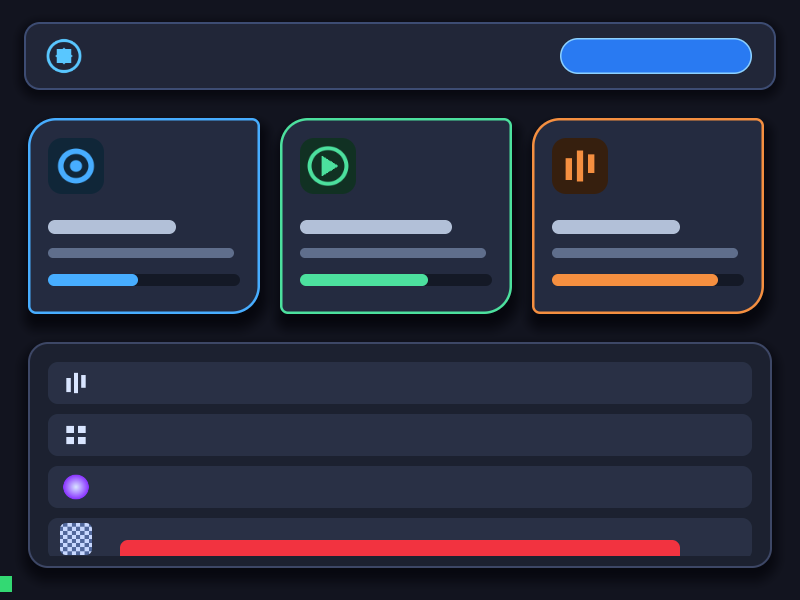

# rhi/2d-sdf-batch

Pure-MoonBit 2D SDF rounded-rectangle + texture-atlas UI batcher and high-frequency dynamic buffer benchmark using `laplaceliu/tycho` (`@tycho`), exercising:

1. **Analytical Per-Corner SDF UI Dashboard (`800×600`)**:
   - Asymmetric per-corner rounded rectangles (`r_tl, r_tr, r_br, r_bl`) with 1px analytical anti-aliasing and borders
   - Analytical soft drop shadows and premultiplied alpha blending (`BlendMode::Premultiplied`)
   - Procedural `256×128` RGBA8 (`4×2` tiles) vector-SDF icon atlas (`create_texture` + `bind_texture`)
   - Hardware scissor clipping (`set_scissor`), including container overflow clipping and negative-origin clip clamping (`-8, 576, 20, 16`)
2. **High-Frequency UI Stress Benchmark (`30 frames × 2,000 animated quads`)**:
   - Single double-buffered `CpuToGpu` ring SSBO (`2 × 2,000 × 96 B`) updated via slice `upload_floats(..., offset=..., count=...)` and bound via `bind_storage(..., offset=..., size=...)`
   - 4 scissor-clipped batches per frame with Dynamic Rendering and `TimestampPool` GPU timing
3. **Interactive Window Mode (`--window`)**:
   - Hover highlight driven by `Swapchain::mouse_pos()`

## Run

```bash
./build.sh
./_build/native/debug/build/laplaceliu/tycho_vulkan_examples/rhi/2d-sdf-batch/2d-sdf-batch.exe
```

## Screenshot



> Runs headless by default for automated verification. Pass `--window` (or `TYCHO_WINDOW=1`) for interactive hover preview, or `--screenshot <path>` to capture PNG.
