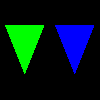

# rhi/indirect-bindless

Tests RHI v0.5 modern GPU capabilities:
- `BufferKind::Indirect` written by a Compute Shader (`dispatch`)
- `CommandBuffer::draw_indirect` (2 draws in 1 GPU-driven call)
- `BindlessHeap` (`Device::create_bindless_heap`, `register_texture`, `bind_bindless_heap`) with `nonuniformEXT` indexing in fragment shader

## Screenshot

> Runs headless by default for automated verification. Pass `--window` (or `TYCHO_WINDOW=1`) to render on screen.
