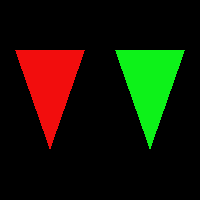

# rhi/mesh

Tests RHI v0.5 capability-gated Mesh Shader pipeline:
- `Device::capabilities().supports_mesh_shader`
- `MeshPipelineDesc::new` + `Device::create_mesh_pipeline`
- `CommandBuffer::draw_mesh_tasks(1, 1, 1)`
- `ShaderStage::Mesh` auto-compiling with SPIR-V 1.4+ (`SHADER_ENV_VULKAN_1_3`)

## Screenshot

> Runs headless by default for automated verification. Pass `--window` (or `TYCHO_WINDOW=1`) to render on screen.
