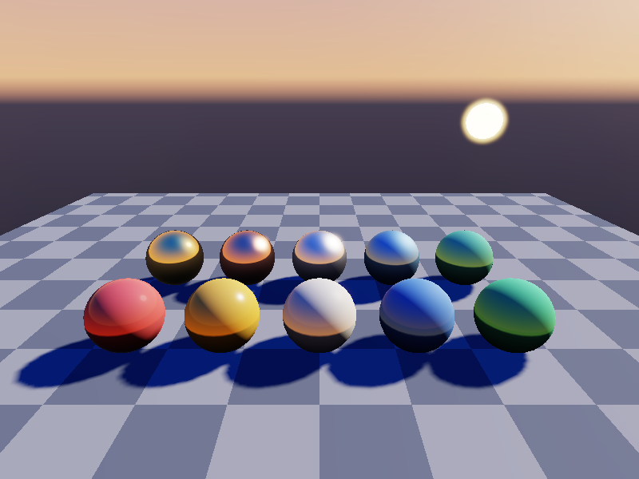

# rhi/pbr-showcase

Flagship pure-MoonBit 3D PBR showcase using `laplaceliu/tycho` (`@tycho`), exercising:
- Procedural UV spheres & ground plane (`GpuOnly` vertex/index buffers + Push Constants)
- Cook-Torrance GGX PBR (2×5 roughness × metallic grid: dielectric vs metallic materials)
- Procedural Cubemap skybox & environment IBL (`create_cubemap`)
- Depth-only `Depth24Stencil8` shadow map (`depth_only=true`, `depth_bias=true`) + 3×3 PCF (`CompareOp::LessEqual`, `ClampToBorder(OpaqueWhite)`)
- HDR `RGBA16F` forward pass + 2-pass separable Gaussian Bloom (`400×300` `RGBA16F`) + ACES filmic tone mapping into `RGBA8Srgb`
- `TimestampPool` GPU timing and WASD/Q/E + arrow/mouse-drag camera controls in `--window` mode

## Run

```bash
./build.sh
./_build/native/debug/build/laplaceliu/tycho_vulkan_examples/rhi/pbr-showcase/pbr-showcase.exe
```

## Screenshot



> Runs headless by default for automated verification. Pass `--window` (or `TYCHO_WINDOW=1`) to explore interactively with WASD / Q / E / Arrow keys or mouse drag.
