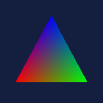

# rhi/rayquery-stencil

Verifies three RHI additions in pure MoonBit:

1. **StencilState & Dynamic Stencil Reference**: Writes a stencil mask (`StencilOp::Replace`, `Depth24Stencil8`) and renders a fullscreen quad with `CompareOp::Equal` + `CommandBuffer::set_stencil_reference(1)`.
2. **`draw_indirect_count`**: Records 2 indirect draw commands into an `Indirect` buffer with `count_buffer = 1`, verifying only the first triangle renders.
3. **Inline Ray Query (`VK_KHR_ray_query`)**: When `DeviceCapabilities::supports_ray_query` is true, builds a `GpuOnly` BLAS (`create_blas`) and TLAS (`create_tlas`), binds it via `bind_accel_struct` to an auto-reflected `GL_EXT_ray_query` compute shader, and verifies triangle hit vs miss pixels (`lavapipe` skips Ray Query cleanly while still verifying Stencil + IndirectCount).

## Run

```bash
./_build/native/debug/build/laplaceliu/tycho_vulkan_examples/rhi/rayquery-stencil/rayquery-stencil.exe
```

## Screenshot


