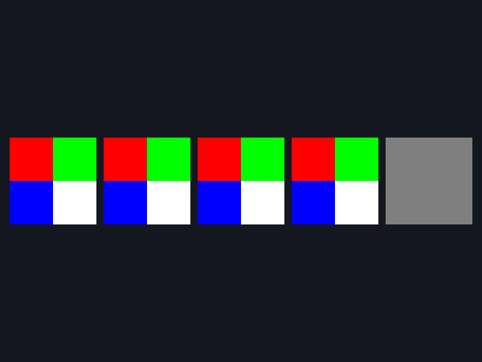

# rhi/reflection-mipmaps

Demonstrates pure-MoonBit SPIR-V reflection (`reflect_spirv` and `PipelineDesc::from_spirv`), GPU mipmap generation (`create_texture_mipmapped`), mip-level readback (`readback_mip`), and explicit sampler LOD clamping (`SamplerDesc` `min_lod`/`max_lod`).

## Run

```bash
./build.sh
./_build/native/debug/build/laplaceliu/tycho_vulkan_examples/rhi/reflection-mipmaps/reflection-mipmaps.exe
```

## Screenshot



> Runs headless by default for automated verification. Pass `--window` (or `TYCHO_WINDOW=1`) to render on screen.
