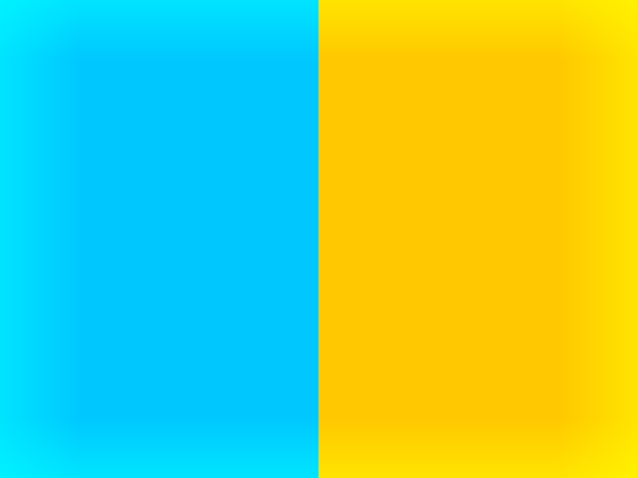

# rhi/textures-samplers

Tests RHI v0.4 texture & sampler extensions:
- `TextureFormat::RGBA16F`, `TextureFormat::R8`, `TextureFormat::RGBA8Srgb`
- `Device::create_cubemap` (6 faces sampled via `samplerCube`)
- `Texture::upload_subregion` (updating an `R8` texture region)
- `CommandBuffer::blit_texture` (800x600 -> 800x600 linear blit)
- `SamplerDesc` with `anisotropy=8.0`, `AddressMode::ClampToBorder`, `BorderColor::OpaqueWhite`

## Screenshot

> Runs headless by default for automated verification. Pass `--window` (or `TYCHO_WINDOW=1`) to render on screen.
