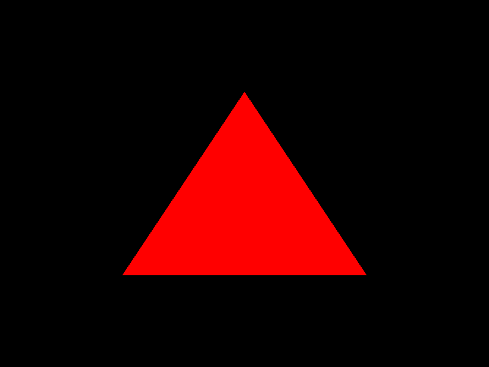

# rhi/triangle

Basic triangle rendered using only the unified `laplaceliu/tycho` (`@tycho`) interface (Vulkan 1.3 dynamic rendering + synchronization2 hidden internally).

## Run

```bash
./build.sh
./_build/native/debug/build/laplaceliu/tycho_vulkan_examples/rhi/triangle/triangle.exe
```

## Screenshot



> Runs headless by default for automated verification. Pass `--window` (or `TYCHO_WINDOW=1`) to render on screen.
