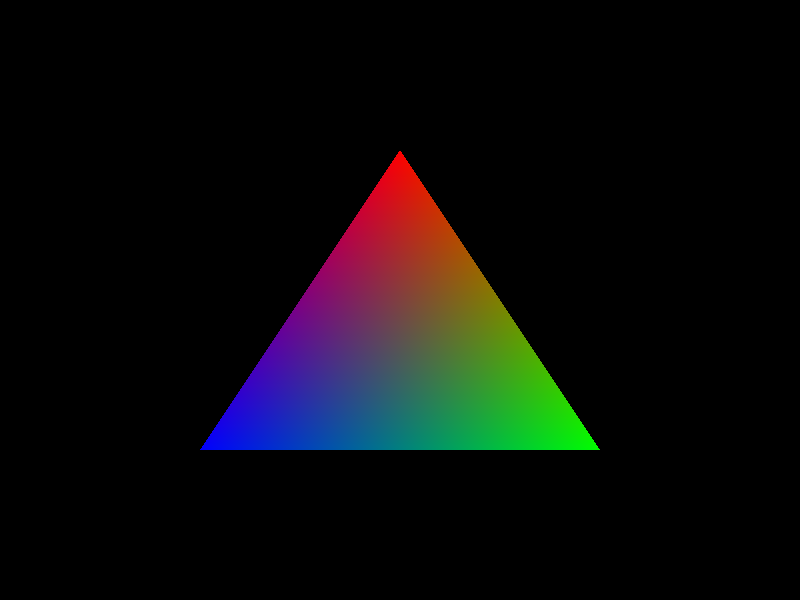

# rhi/vertex

Vertex buffer input attributes (`Float2` position + `Float3` color) through `@tycho`.

## Run

```bash
./build.sh
./_build/native/debug/build/laplaceliu/tycho_vulkan_examples/rhi/vertex/vertex.exe
```

## Screenshot



> Runs headless by default for automated verification. Pass `--window` (or `TYCHO_WINDOW=1`) to render on screen.
