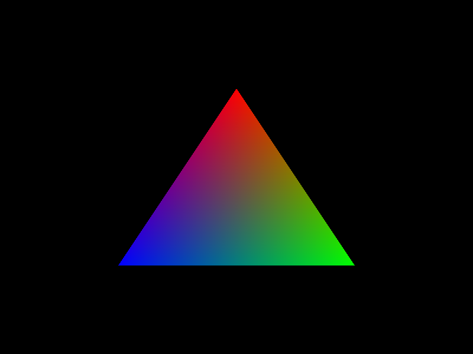

# vulkan/dynamic-rendering

Example 14 — Vulkan 1.3 dynamic rendering + synchronization2 (no render pass,

no framebuffer). Exercises three binding capabilities end to end:
1. typed pNext chains: features2 -> Vulkan13Features, pipeline -> RenderingCreateInfo
2. the generated debug messenger (capture-free callback + read_cstr)
3. vkCmdPipelineBarrier2 / vkCmdBeginRendering / vkQueueSubmit2
Pure MoonBit; verifies by pixel readback and by a deliberate validation error.

## Window Screenshot



## Run

```bash
./build.sh
./_build/native/debug/build/laplaceliu/tycho_vulkan_examples/vulkan/dynamic-rendering/dynamic-rendering.exe
```

## Output

```text
[14-dyn] apiVersion=4211017 dynamicRendering=1 synchronization2=1
[14-dyn] submit2=0 rendered pixels=60000/480000
[14-dyn] frames=179 validation messages=0 errors=0
[14-dyn] VALIDATION ERROR: vkCreateBuffer(): pCreateInfo->size is zero.
The Vulkan spec states: size must be greater than 0 (https://vulkan.lunarg.com/doc/view/1.4.363.1/linux/antora/spec/latest/chapters/resources.html#VUID-VkBufferCreateInfo-size-00912)
[14-dyn] VALIDATION ERROR: vkCreateBuffer(): pCreateInfo->usage is zero.
The Vulkan spec states: If the pNext chain does not include a VkBufferUsageFlags2CreateInfo structure, usage must not be 0 (https://vulkan.lunarg.com/doc/view/1.4.363.1/linux/antora/spec/latest/chapters/resources.html#VUID-VkBufferCreateInfo-None-09500)
[14-dyn] negative control: deliberate invalid buffer provoked 2 errors
[14-dyn] OK — dynamic rendering + sync2 drew 60000 pixels over 179 frames, 0 validation errors, messenger proven live
```
