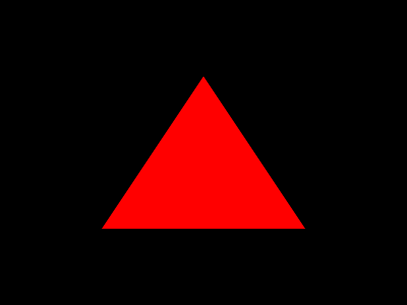

# vulkan/slang

Example 07 — Slang shader triangle (compile_slang via bundled official slangc).

Pure MoonBit binding. Verifies rendering by reading back rendered pixels.

## Window Screenshot



## Run

```bash
./build.sh
./_build/native/debug/build/laplaceliu/tycho_vulkan_examples/vulkan/slang/slang.exe
```

## Output

```text
[vulkan/slang] instance=0 device=0
[vulkan/slang] graphics pipeline = 0
[vulkan/slang] acquire=0 submit=0 rendered pixels=60000/480000
[vulkan/slang] present=0 (0=VK_SUCCESS)
[vulkan/slang] OK — triangle rendered (60000 non-zero pixels) and presented
```
