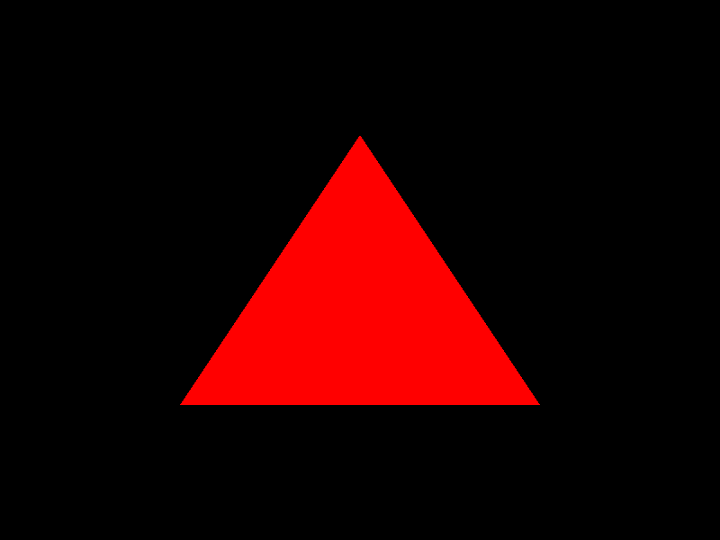

# vulkan/triangle

Example 03 — Drawing a triangle (vulkan-tutorial.com/Drawing_a_triangle).

Pure MoonBit binding. Verifies rendering by reading back rendered pixels.

## Window Screenshot



## Run

```bash
./build.sh
./_build/native/debug/build/laplaceliu/tycho_vulkan_examples/vulkan/triangle/triangle.exe
```

## Output

```text
[vulkan/triangle] instance=0 device=0
[vulkan/triangle] graphics pipeline = 0
[vulkan/triangle] acquire=0 submit=0 rendered pixels=60000/480000
[vulkan/triangle] present=0 (0=VK_SUCCESS)
[vulkan/triangle] OK — triangle rendered (60000 non-zero pixels) and presented
```
