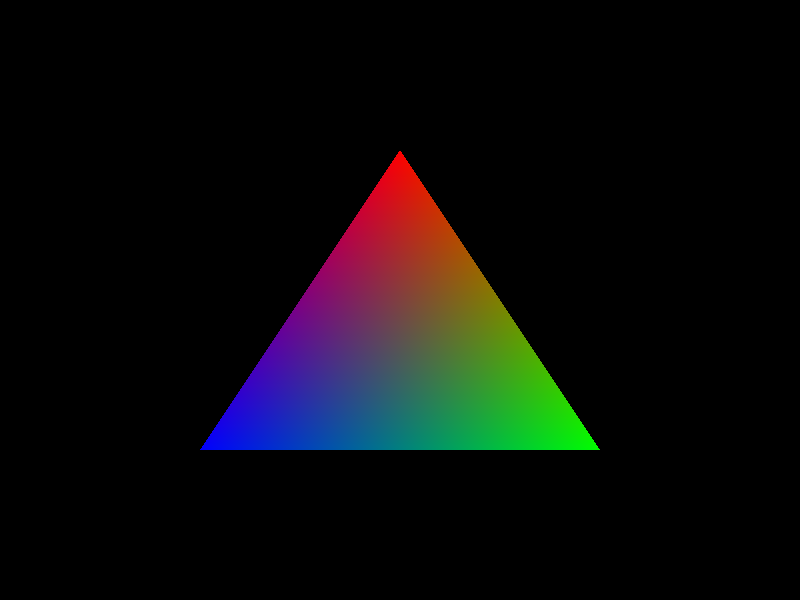

# vulkan/vertex-buffer

Example 04 — Vertex buffers (vulkan-tutorial.com/Vertex_buffers).

Vertex input descriptions + vertex/staging buffers + device memory + copy command.
Memory-type selection uses the generated nested/array getters (pure MoonBit).

## Window Screenshot



## Run

```bash
./build.sh
./_build/native/debug/build/laplaceliu/tycho_vulkan_examples/vulkan/vertex-buffer/vertex-buffer.exe
```

## Output

```text
[04-vbuf] upload=0 vertex buffer created
[04-vbuf] graphics pipeline (vertex input) = 0
[render] non-zero pixels=60000/480000
[04-vbuf] acquire=0 submit=0 present=0 (0=VK_SUCCESS)
[04-vbuf] OK — vertex buffer chapter validated
```
